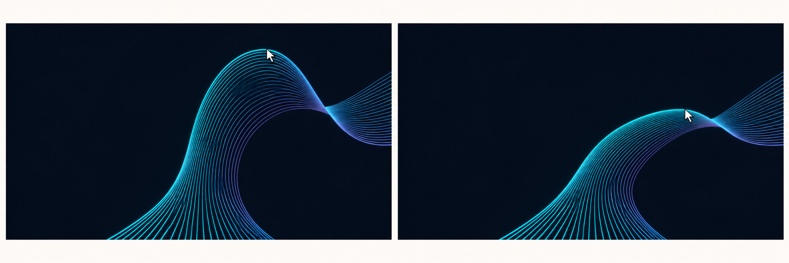

# Niti

**Grupa 2** · Sara Barbarić, Marko Grladinović, Patrick Lihtenvalner i Dorian Mikulan  
Kreativno programiranje za interaktivne medije · 2026./2027.

## Ukratko

Planiramo izraditi generator pozadina za desktop u kojem korisnik mišem oblikuje vrpcu od svjetlećih niti. Kad pronađe kompoziciju koja mu odgovara, moći će je spremiti kao PNG od 2560 × 1440 px.

## Kako pokrenuti

Projekt je u fazi ideje (KT1). Upute za pokretanje u Thonnyju dodat ćemo uz prvu radnu verziju.

## Upute za korištenje

| Planirana radnja | Učinak |
|---|---|
| Pomicanje miša | Zavoj postupno prati pokazivač dok krajevi vrpce ostaju uz rubove kadra. |
| Spremanje kadra | Izvoz odabrane pozadine bez pokazivača. |

## Ideja i proces

Krenuli smo od ideje o pozadinama s jarkim linijama na tamnoj podlozi. Odabrali smo vrpcu čije se niti u zavoju približavaju i zatim ponovno razmiču. Na skici smo usporedili dva položaja pokazivača. U prototipu želimo ispitati koliko brzo vrpca treba pratiti miš da pokret bude gladak i da korisnik osjeti kontrolu.

## Tehnički opis

Planiramo raditi u Pythonu i biblioteci py5. Prvi prototip trebao bi prikazati i pomicati vrpcu u jednoj paleti. U završnoj fazi planiramo izvoz u punoj rezoluciji i testiranje na drugom računalu.

## Podjela rada

| Član grupe | Uloga | Dio koda |
|---|---|---|
| Patrick Lihtenvalner | Oblik vrpce | Programira putanju vrpce i razmak između niti u zavoju. |
| Marko Grladinović | Interakcija i pokret | Povezuje položaj miša sa zavojem i podešava brzinu kojom vrpca prati pokazivač. |
| Dorian Mikulan | Boja, svjetlo i dubina | Programira boju, svjetlinu i sjaj niti tako da se vidi uvijanje vrpce. |
| Sara Barbarić | Pregled i izvoz | Programira pregled i spremanje odabranog kadra kao PNG od 2560 × 1440 px. |

## Izvori, licence i atribucija

Konceptualna skica u mapi `dokumentacija/` izrađena je uz ChatGPT prema opisu projekta.

## Korištenje AI alata

Član grupe predložio je generator pozadina, a grupa je potvrdila smjer projekta. ChatGPT smo koristili pri razradi interakcije, izradi konceptualne skice, pripremi dokumentacije i razmatranju moguće podjele rada.

## Licenca ovog rada

Grupa će odabrati licencu prije završne objave.
